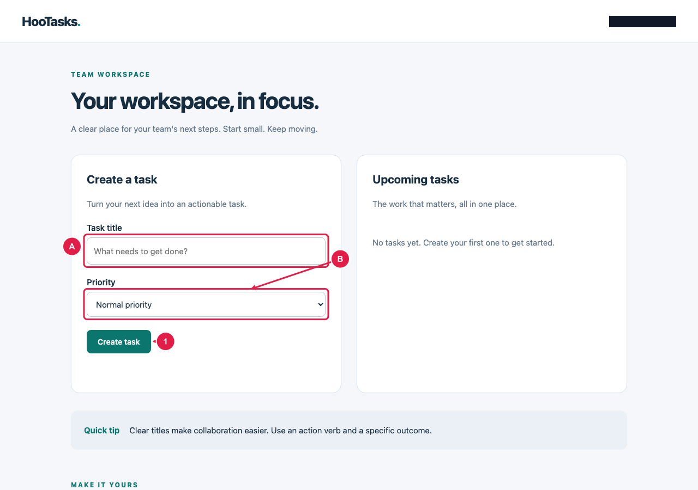

# hooserguide

Turn a browser workflow into an illustrated user manual. Write a Gherkin scenario with instructions, assertions and the screenshots you want. Playwright runs it against your app; hooserguide exports an offline HTML handbook, a PDF, Markdown and a JSON record of what passed. You can author scenarios yourself or with an agent. No model or API key is required.



[Documentation wiki](https://github.com/openhoo/hooserguide/wiki) · [Live handbook](https://openhoo.github.io/hooserguide/) · [Example PDF](https://github.com/openhoo/hooserguide/blob/main/docs/demo/handbook.pdf) · [Offline guide ZIP](https://github.com/openhoo/hooserguide/raw/refs/heads/main/docs/demo/handbook.zip)

## Try the demo

With Node.js 22 or newer and npm:

```sh
git clone https://github.com/openhoo/hooserguide.git
cd hooserguide
npm ci
npx playwright install chromium
npm run demo
```

The demo starts HooTasks on localhost, creates a task and saves a notification preference. Open the printed HTML or PDF path. Each run gets its own directory; keep the screenshots next to the HTML and Markdown when opening them offline.

## Document your app

From your application project, install the tool and create a guide:

```sh
npm install -D github:openhoo/hooserguide#0.9.0
npx playwright install chromium
npx hooserguide init docs/user-guide --base-url http://localhost:3000 --editor
```

Start your app at that URL. Edit `docs/user-guide/features/get-started.feature` to match one task a reader needs to complete. For example, this scenario tells the reader what to do, checks the result after a reload and captures it for the guide:

```gherkin
@manual
Feature: Workspace preferences
  Scenario: Keep email notifications enabled
    Given I open "/"
    And I explain "Enable Email notifications and select Save preferences."
    When I check "label=Email notifications"
    And I click "role=button:Save preferences"
    And I reload the page
    Then "label=Email notifications" is checked
    And I capture "Your saved preference"
      """json
      {
        "marks": [
          { "target": "label=Email notifications", "label": "A", "caption": "Email notifications are enabled." }
        ]
      }
      """
```

From the same project directory:

```sh
npx hooserguide lint --config docs/user-guide/hooserguide.config.json
npx hooserguide run --config docs/user-guide/hooserguide.config.json
```

`lint` checks the spec without opening the app. `run` performs its actions, so use a test account and data you can change. A failed assertion or missing privacy mask prevents a successful export. Configure masks for private fields and review both screenshot variants before sharing. A passing report covers only the scenarios and screen profiles that ran.

## Where to go next

| I want to…                                              | Read                                                                                                                                                 |
| ------------------------------------------------------- | ---------------------------------------------------------------------------------------------------------------------------------------------------- |
| Write a chapter, find a step or use the editor          | [Authoring guide](docs/authoring.md) · [Steps, selectors and config](docs/reference.md)                                                              |
| Annotate a control, mask a field or crop a screenshot   | [Lettered arrows and line widths](docs/reference.md#connect-a-reference-badge-to-a-control) · [Capture options](docs/reference.md#capture-docstring) |
| Compare desktop, tablet and mobile screenshots          | [Responsive guides](docs/responsive.md)                                                                                                              |
| Change the theme, rebuild a PDF or share an offline ZIP | [Customization and delivery](docs/customization.md) · [Rebuild from existing evidence](docs/advanced.md#rebuild-from-existing-evidence)              |
| Connect an agent or reuse a Playwright test             | [MCP, TypeScript API and agent skills](docs/integration.md)                                                                                          |
| Generate in CI or publish a static handbook             | [GitLab component](docs/gitlab.md) · [GitHub and GitLab Pages](docs/pages.md)                                                                        |

Add `--skills` to `init` to install the [author](skills/hooserguide-author/SKILL.md) and [review](skills/hooserguide-review/SKILL.md) instructions alongside your guide. Run `npx hooserguide --help` for the full command list.

For work on hooserguide itself, see [Contributing](CONTRIBUTING.md), [Architecture](docs/architecture.md), [Review evidence](docs/review.md) and the [Changelog](CHANGELOG.md).

[Apache-2.0](LICENSE). Vendored pdfcn components retain their [MIT attribution](THIRD_PARTY_NOTICES.md).
