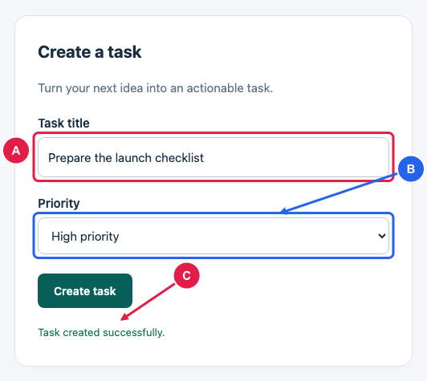

# Advanced workflows

Use these recipes when a basic scenario needs [a close-up](#capture-a-specific-panel), [a form table](#fill-a-form-using-a-gherkin-table), [one browser profile](#named-browser-profiles) or [a new export of existing evidence](#rebuild-from-existing-evidence). Run the CLI examples from the directory containing your guide config.

## Capture a specific panel

This capture from the [HooTasks example](../examples/tasks.feature) keeps the task form readable without surrounding navigation:

```gherkin
And I capture "Task form in detail"
  """json
  {
    "focus": "css=.grid > .card:first-child",
    "padding": 18,
    "autoLabels": "letters",
    "description": "After you select Create task, look below the button for the save confirmation (C).",
    "marks": [
      { "target": "label=Task title", "kind": "box", "caption": "Your task title." },
      { "target": "label=Priority", "kind": "both", "color": "#2563eb", "caption": "The selected priority." },
      { "target": "role=status:Task result", "kind": "arrow", "caption": "The save confirmation." }
    ]
  }
  """
```

The focus target must be one visible element and contain every mark after padding. The browser takes a masked full-page image, then crops both variants; the report keeps the crop's document coordinates. Explicit arrow origins are relative to the final crop. Very large documents are still subject to the browser's full-page screenshot limits.

With `autoLabels: "letters"`, marks get A through Z, then AA, AB and so on. Explicit labels are preserved and skipped by the sequence. See the [capture reference](reference.md#capture-docstring) for numeric labels, padding limits and mask behavior.



## Fill a form using a Gherkin table

```gherkin
When I fill the form:
  | selector | value |
  | label=Name | Demo User |
  | label=Email | demo@example.test |
Then "label=Name" has value "Demo User"
And "role=button:Save" is enabled
When I click "role=button:Save"
And I reload the page
Then "label=Name" has value "Demo User"
```

Use two separate header cells named `selector` and `value` and at least one data row. Every row fills a text input. Use `I select` or `I check` for other controls and the [environment-fill step](reference.md#navigate-and-interact) for credentials. A reload after saving distinguishes a persisted change from text still sitting in the form.

The [step catalogue](reference.md#built-in-step-phrases) also covers uploads (paths resolve relative to the feature file), drag and drop, hover and history navigation.

## Named browser profiles

For one mobile run, use the `mobile` profile already supplied by `init`:

```sh
npx hooserguide validate --profile mobile
npx hooserguide run --profile mobile --json
```

Add named entries to the config's `profiles` object when you need another viewport or color scheme. For example, this fragment defines a narrow, dark browser:

```json
{
  "profiles": {
    "mobile-dark": {
      "viewport": { "width": 390, "height": 844 },
      "deviceScaleFactor": 2,
      "isMobile": true,
      "hasTouch": true,
      "colorScheme": "dark"
    }
  }
}
```

A profile inherits the base viewport, scale factor and browser unless it overrides them. Set `profile` for the default selection; unknown names fail before launch. Install the chosen browser engine. For Firefox, use a narrow viewport and omit `isMobile: true`.

The report records the selected profile, effective viewport and step durations. To show several screens side by side in one handbook, use a [responsive run](responsive.md).

## Rebuild from existing evidence

Use `build` after changing the cover, theme or PDF layout. Set `RUN` to the directory printed by a successful `run` and choose an output outside it:

```sh
RUN="output/hooserguide/run-…"
npx hooserguide build "$RUN" --config hooserguide.config.json --output output/rebuilt --json
```

With `--config`, the new handbook uses the project's branding, document metadata, manual options and PDF setting. With no `--output`, builds go under a sibling `rebuilt` directory. `--no-pdf` exports HTML and Markdown. The app is never opened; if the workflow, selectors or masks changed, edit the feature or config and generate a new run.

A rebuild needs only the original report and its verified, decodable PNGs. It copies both image variants byte for byte, leaves unhashed SVG overlays in the original run, and checks that even a symlinked output resolves outside the source. The new report retains the original `generatedAt` and adds `rebuiltAt` and `sourceReportSha256`. Older runs without raw-image hashes have the [documented integrity limitation](reference.md#evidence-integrity).

```ts
import { build } from '@openhoo/hooserguide';

const result = await build(runDirectory, {
  output: 'output/rebuilt',
  branding: { name: 'Acme', accentColor: '#7c3aed' },
});
if (result.report.status !== 'passed') throw new Error(result.report.exportError);
```

For MCP, pin the `runId` in `hooserguide_rebuild` so you re-export the evidence you reviewed. See the [MCP workflow](integration.md).

## Customization, comparison and portable delivery

See [customization and sharing](customization.md) for tag expressions, fail-fast, localized callouts, document metadata, A4/Letter layouts, screenshot defaults, offline HTML controls, verified run comparison and ZIP bundles.
