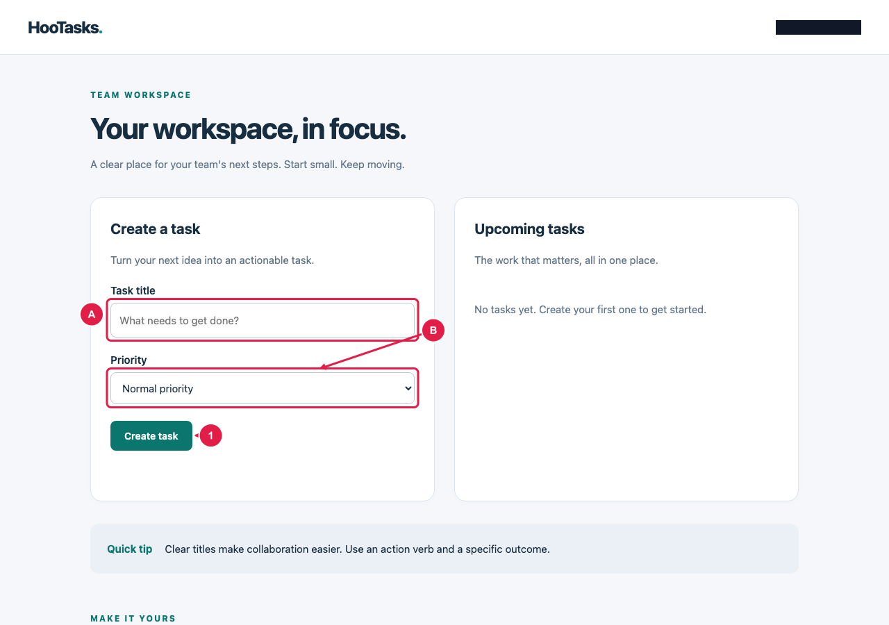
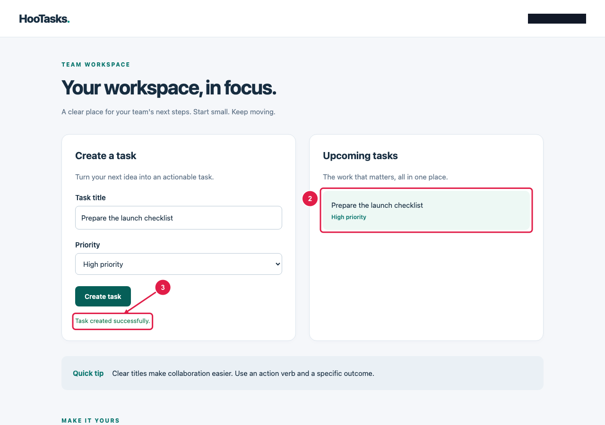
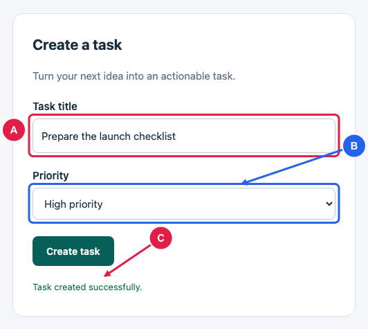
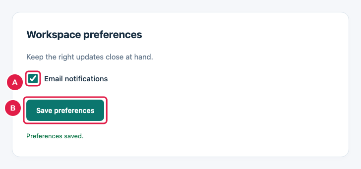

# HooTasks — User guide

Guide version: 1.0
Audience: Workspace members
Generated: 2026-11-25

Create, organize and verify tasks in your HooTasks workspace.

## Contents

1. Create your first task
2. Customize workspace notifications

## 1. Create your first task

Add a task and check that its title and priority are still in the list after you reload.

### Prerequisites

- Open your workspace with permission to create tasks.

> **Tip:** Use a short title that describes the next action.

1. Enter a clear task title and choose its priority.
2. Select Create task. Check that the task appears in the list and that a confirmation is shown.
3. Reload the page. Under Upcoming tasks, check that your task still shows the title and priority you chose.

### Fill in the task details

A names your task. B controls its priority. Select Create task to save it.

- **A**: Give the task a descriptive title.
- **B**: Choose a priority for your team.
- **1**: Save the new task.

### Check the saved task

The task now appears in your workspace. The confirmation shows that the save completed.

- **2**: Your newly created task.
- **3**: Successful save confirmation.

### Task form in detail

After you select Create task, look below the button for the save confirmation \(C\).

- **A**: Your task title.
- **B**: The selected priority.
- **C**: The save confirmation.

## 2. Customize workspace notifications

Choose whether to receive email notifications and save that choice for this browser session.

> **Note:** Preferences are configured separately from individual tasks.

> **Warning:** Enable email notifications only for an account you control.

1. Scroll below the task list to Workspace preferences. Select Email notifications, then Save preferences.
2. Look for the message “Preferences saved.” below the button.

### Workspace preferences

Under Workspace preferences, select Email notifications \(A\), then Save preferences \(B\).

- **A**: Turn notifications on or off.
- **B**: Save your preferences.
