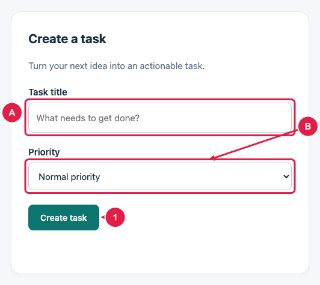
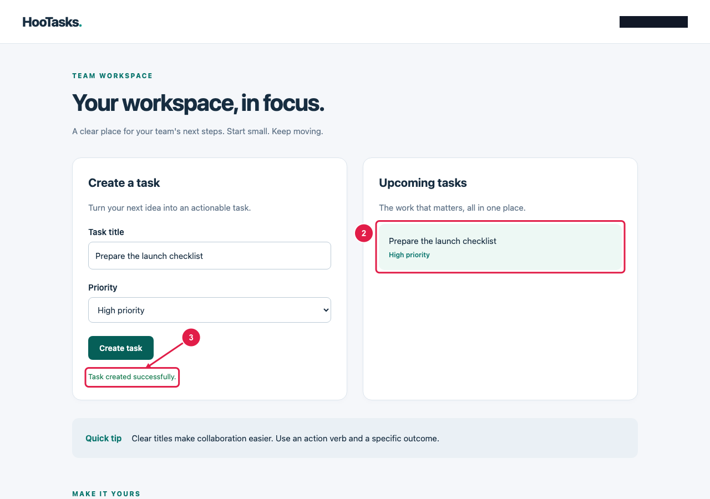
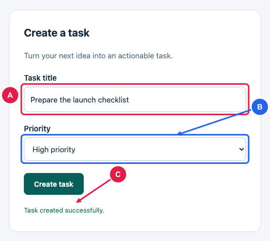
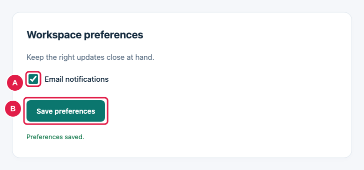

# HooTasks — Benutzerhandbuch

Handbuchversion: 1.0
Zielgruppe: Teammitglieder
Erstellt: 2026-11-25

Aufgaben anlegen, organisieren und Ergebnisse prüfen.

## Inhalt

1. Die erste Aufgabe anlegen
2. Benachrichtigungen anpassen

## 1. Die erste Aufgabe anlegen

Legen Sie eine Aufgabe an. Prüfen Sie nach dem Neuladen, ob Titel und Priorität weiterhin in der Liste stehen.

### Voraussetzungen

- Öffnen Sie Ihren Arbeitsbereich mit der Berechtigung, Aufgaben anzulegen.

> **Tipp:** Verwenden Sie einen kurzen Titel, der den nächsten Arbeitsschritt beschreibt.

1. Geben Sie einen eindeutigen Aufgabentitel ein und wählen Sie die Priorität.
2. Wählen Sie Create task. Prüfen Sie, ob die Aufgabe in der Liste und eine Bestätigung erscheinen.
3. Laden Sie die Seite neu. Prüfen Sie unter Upcoming tasks, ob Titel und Priorität Ihrer Aufgabe unverändert sind.

### Aufgabendetails ausfüllen

A bezeichnet den Titel, B die Priorität. Wählen Sie Create task zum Speichern.

- **A**: Geben Sie der Aufgabe einen aussagekräftigen Titel.
- **B**: Wählen Sie eine passende Priorität für Ihr Team.
- **1**: Speichern Sie die neue Aufgabe.

### Gespeicherte Aufgabe prüfen

Die Aufgabe erscheint im Arbeitsbereich. Die Bestätigung zeigt den erfolgreichen Speichervorgang.

- **2**: Die neu angelegte Aufgabe.
- **3**: Bestätigung des erfolgreichen Speicherns.

### Aufgabenformular im Detail

Nach dem Speichern mit Create task erscheint unter der Schaltfläche die Bestätigung \(C\).

- **A**: Der Aufgabentitel.
- **B**: Die gewählte Priorität.
- **C**: Die Speicherbestätigung.

## 2. Benachrichtigungen anpassen

Legen Sie für diese Browsersitzung fest, ob Sie E-Mail-Benachrichtigungen erhalten möchten.

> **Hinweis:** Einstellungen werden getrennt von den einzelnen Aufgaben gespeichert.

> **Warnung:** Aktivieren Sie E-Mail-Benachrichtigungen nur für ein Konto, das Sie kontrollieren.

1. Scrollen Sie unter die Aufgabenliste zu Workspace preferences. Aktivieren Sie Email notifications und wählen Sie Save preferences.
2. Unter der Schaltfläche erscheint die Meldung „Preferences saved.“

### Einstellungen des Arbeitsbereichs

Wählen Sie unter Workspace preferences die Option Email notifications \(A\) und dann Save preferences \(B\).

- **A**: Schalten Sie Benachrichtigungen ein oder aus.
- **B**: Speichern Sie Ihre Einstellungen.
