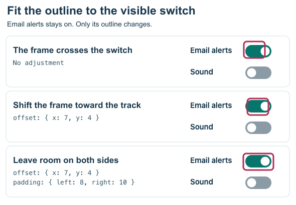
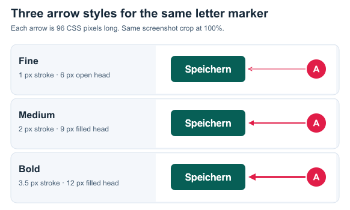

# Configuration and step reference

Look up [configuration](#configuration), [selectors](#selectors), [step phrases](#built-in-step-phrases), [screenshot options](#capture-docstring) or [report fields](#reports-and-failures). For a first scenario, follow the [authoring guide](authoring.md).

## Configuration

Save this as `hooserguide.config.json` beside your `features/` directory and point `baseURL` at your running app:

```json
{
  "title": "Workspace guide",
  "baseURL": "http://localhost:3000",
  "features": ["features/*.feature"]
}
```

Unknown fields are rejected. The [configuration schema](../schemas/config.schema.json) lists accepted values; the [editor setup](authoring.md#start-with-an-editor-workspace) installs a local copy.

| Field               | Default       | Meaning                                                                            |
| ------------------- | ------------- | ---------------------------------------------------------------------------------- |
| `title`             | required      | Handbook title                                                                     |
| `baseURL`           | required      | HTTP(S) application URL for relative navigation                                    |
| `features`          | required      | Nonempty array of feature paths or glob patterns                                   |
| `output`            | `output`      | Parent directory for isolated runs                                                 |
| `tag`               | all scenarios | One tag such as `@manual`                                                          |
| `tagExpression`     | none          | Cucumber tag expression; overrides `tag`                                           |
| `scenario`          | none          | Case-insensitive scenario-name substring                                           |
| `failFast`          | false         | Stop after first failed scenario and record skipped coverage                       |
| `document`          | none          | Guide/product version, audience and summary                                        |
| `manual`            | A4 portrait   | Theme, page size, orientation, margin, contents and date visibility                |
| `captureDefaults`   | none          | Default auto-labels, mark color, focus padding and fullPage                        |
| `language`          | `en`          | Browser locale and document language tag                                           |
| `viewport`          | 1280 × 800    | Browser CSS viewport width/height                                                  |
| `deviceScaleFactor` | 1             | Browser scale factor; screenshots still use CSS pixels                             |
| `browser`           | `chromium`    | Chromium, Firefox or WebKit                                                        |
| `headed`            | false         | Open a visible browser for debugging                                               |
| `timeoutMs`         | 10000         | Browser action/assertion timeout, 100–120000 milliseconds                          |
| `storageState`      | none          | Local Playwright authentication state file                                         |
| `masks`             | none          | Privacy selectors applied to every capture                                         |
| `plugins`           | none          | Trusted local ESM step modules                                                     |
| `pdf`               | true          | Enable pdfcn / Forme PDF export                                                    |
| `profiles`          | none          | Named browser settings; see [profile examples](advanced.md#named-browser-profiles) |
| `profile`           | base settings | Default profile name; `--profile` overrides it                                     |
| `responsive`        | none          | Two to four profiles, their order, labels and [presentation layout](responsive.md) |
| `branding`          | hooserguide   | Display name, subtitle and six-digit hex accent color                              |

Paths in `features`, `output`, `plugins` and `storageState` resolve relative to the config file. When passing a config object directly to `run()`, relative paths resolve from the process working directory. Each feature pattern must match; files are sorted and deduplicated. Each selected scenario gets a fresh browser context and the configured storage state.

### Theme selection

`manual.theme` sets the default HTML and PDF theme. `--theme` overrides it for `run` and `build`. See [manual themes](customization.md#manual-themes) for the six presets and reader controls.

## Selectors

| String             | Object equivalent                 |
| ------------------ | --------------------------------- |
| `role=button:Save` | `{"role":"button","name":"Save"}` |
| `label=Email`      | `{"label":"Email"}`               |
| `text=Saved`       | `{"text":"Saved"}`                |
| `testid=save`      | `{"testId":"save"}`               |
| `css=#save`        | `{"css":"#save"}`                 |
| `#save`            | `{"css":"#save"}`                 |

Use string selectors inside Gherkin steps. In a capture or config, you can also use the object form. Accessible names, labels and text match exactly; `role=button:Save: draft` selects a button named “Save: draft”. Unprefixed strings go to Playwright. Annotation and focus targets require one visible element. Each privacy selector must match at least one element and can mask several.

## Built-in step phrases

Use `npx hooserguide steps --search save` to find a phrase. Add `--config hooserguide.config.json` to include local plugins, or `--json` for the binding patterns, examples and descriptions. The phrases below are case-sensitive. Gherkin keywords may be localized; escape quotes inside arguments as `\"`.

### Navigate and interact

| Phrase                                             | Effect                                                         |
| -------------------------------------------------- | -------------------------------------------------------------- |
| `I open "/settings"`                               | Navigate and wait for DOM content                              |
| `I click "role=button:Save"`                       | Click a locator                                                |
| `I fill "label=Name" with "Demo"`                  | Fill a text field                                              |
| `I fill "label=Password" from env "APP_PASSWORD"`  | Fill without storing the value in the feature/report step text |
| `I select "high" in "label=Priority"`              | Select an option by value                                      |
| `I check "label=Notifications"`                    | Check a checkbox                                               |
| `I uncheck "label=Notifications"`                  | Uncheck a checkbox                                             |
| `I press "Enter" on "label=Search"`                | Send a key to a locator                                        |
| `I scroll to "testid=preferences"`                 | Scroll a locator into view                                     |
| `I fill the form:`                                 | Fill inputs from a selector/value data table                   |
| `I hover "role=button:Help"`                       | Hover a locator                                                |
| `I double click "testid=item"`                     | Double-click a locator                                         |
| `I clear "label=Search"`                           | Clear an input                                                 |
| `I upload "fixtures/avatar.png" to "label=Avatar"` | Upload a feature-relative file                                 |
| `I drag "testid=task" to "testid=column"`          | Drag an element to another element                             |
| `I reload the page`                                | Reload for persistence checks                                  |
| `I go back` / `I go forward`                       | Navigate browser history                                       |

### Check the result

| Phrase                                                              | Effect                                 |
| ------------------------------------------------------------------- | -------------------------------------- |
| `"role=heading:Settings" is visible`                                | Retry a visibility assertion           |
| `"role=status:Result" has text "Saved"`                             | Retry an exact text assertion          |
| `"testid=loading" is hidden`                                        | Assert hidden or detached state        |
| `"role=button:Save" is enabled` / `is disabled`                     | Assert control state                   |
| `"label=Notifications" is checked` / `is unchecked`                 | Assert checkbox state                  |
| `"label=Name" has value "Demo"`                                     | Assert an input value                  |
| `"testid=tasks" contains text "Launch"`                             | Assert a substring                     |
| `"css=.task" has count 3`                                           | Assert the match count                 |
| `"role=button:Save" has attribute "aria-pressed" with value "true"` | Assert an attribute                    |
| `the URL is "/settings"`                                            | Assert exact URL relative to `baseURL` |
| `the page title is "Settings"`                                      | Assert the document title              |

### Write instructions and take screenshots

| Phrase                                         | Effect                                            |
| ---------------------------------------------- | ------------------------------------------------- |
| `I explain "Select Save."`                     | Add user-facing prose to the chapter              |
| `I add a prerequisite "Sign in as an editor."` | Add a descriptive chapter prerequisite            |
| `I add a note "Only your profile changes."`    | Add an informational callout                      |
| `I add a tip "Use a recognizable name."`       | Add a tip callout                                 |
| `I add a warning "Review before saving."`      | Add a warning callout                             |
| `I capture "Settings"`                         | Capture and optionally annotate the current state |

Only `I explain:` (plain-text docstring), `I capture "…"` (JSON object docstring) and `I fill the form:` (two-column data table) accept attached arguments. Built-in chapters need at least one capture. Validation catches invalid shorthand, URLs that cannot resolve against `baseURL`, and counts outside the safe integer range before browser actions. Trusted plugins define and validate their own steps and may take screenshots.

Use the environment-fill step for credentials. Its failure message names the variable without retaining the browser's fill log. Explicitly mask the field if the value can appear in screenshots.

## Capture docstring

```gherkin
And I capture "Settings"
  """json
  {
    "description": "Check reference A before saving.",
    "fullPage": false,
    "masks": ["testid=private-email"],
    "marks": [
      {
        "target": { "role": "button", "name": "Save" },
        "kind": "arrow",
        "label": "A",
        "caption": "Save your changes.",
        "color": "#e11d48",
        "leader": { "side": "auto", "length": 72 }
      }
    ]
  }
  """
```

| Option                           | Behavior                                                                                                                                                                                                                                                                                                                                    |
| -------------------------------- | ------------------------------------------------------------------------------------------------------------------------------------------------------------------------------------------------------------------------------------------------------------------------------------------------------------------------------------------- |
| `marks[].kind`, `color`          | `box` (default), `arrow` or `both`. Colors use six-digit hex codes.                                                                                                                                                                                                                                                                         |
| `label`, `caption`, `autoLabels` | Labels contain 1–4 ASCII letters or digits and must be unique per capture. Captions become legends. Captioned marks get numbers by default, while marks with `leader` get letters. Choose `"letters"` or `"numbers"` to set automatic labels; explicit labels take precedence. Older captions without labels remain unchanged when rebuilt. |
| `marks[].leader`                 | Connect a reference badge to its target with a configurable arrow. With `leader`, omitted `kind` means `arrow`; use `both` to add an outline.                                                                                                                                                                                               |
| `marks[].offset`                 | Shift the annotation target relative to the measured element: `{"x": 6, "y": -2}` moves it right 6 and up 2 screenshot CSS pixels. Omitted axes are zero.                                                                                                                                                                                   |
| `marks[].padding`                | Expand (positive) or inset (negative) the annotation target. A number applies to all edges; an object sets `top`, `right`, `bottom` or `left`. Omitted edges are zero.                                                                                                                                                                      |
| `marks[].from`                   | Optional arrow origin in screenshot CSS pixels. With `leader`, sets the exact badge center.                                                                                                                                                                                                                                                 |
| `fullPage`                       | Default `false`: scroll the first mark into view and require all marks to fit. Use `true` to capture the document from its origin. Viewport crops on zoomed mobile pages account for the visual viewport.                                                                                                                                   |
| `focus`, `padding`               | Crop around one visible element with 24 CSS pixels of padding by default (0–500 allowed). Marks must fit in the crop. See the [focused capture example](advanced.md#capture-a-specific-panel).                                                                                                                                              |
| `masks`                          | Mask these targets in addition to the global config masks. Original and annotated PNGs come from the same masked image.                                                                                                                                                                                                                     |

Each privacy selector must match after the page settles. If its match count or bounds change while the browser takes the screenshot, neither image is saved. Review both variants for any private information your masks did not cover. Font and animation-frame waits honor `timeoutMs`. Motion is paused for measuring; previously paused animations stay paused. Boxes, arrows and labels are drawn onto the captured image.

### Adjust the area a mark points to

Mark offsets and mark padding are available in 0.11.0 and later.

Use the most specific visible target first. An icon button may have a large clickable area around a small glyph; sometimes the stable accessible locator identifies the button but the glyph has no separate locator. Use `offset` to shift the marked area and `padding` to resize it. For example, on a 44 × 44 pixel button with a 20 × 20 glyph four pixels right of center:

```json
{
  "target": "role=button:Edit",
  "kind": "box",
  "label": "A",
  "caption": "Open the editor.",
  "padding": -12,
  "offset": { "x": 4 }
}
```

The adjusted region is 20 × 20 before the normal outline clearance is added. To change only one edge, use an object: `"padding": {"top": -4, "right": 8}` starts the mark four pixels lower and extends it eight pixels to the right. Distances are in the final screenshot's CSS pixels; each axis or edge accepts a number from −2000 to 2000, including fractions. Omitting an option, using an empty object, or setting all its values to zero preserves the original placement.

The measured element stays in `report.json` as `marks[].bounds`. Hooserguide uses the adjusted area to place the outline, badge and arrow; an explicit `from` still uses fixed coordinates in the final image. Neither option changes the masked original or the focus crop. For more space around a **screenshot**, set the capture's top-level `padding` alongside `focus`. Capture rejects a region that collapses, leaves the image, or newly overlaps another marked control whose measured bounds did not overlap this one. Unmarked neighbors still need a visual check. Correct the values, or give a tight crop more room; then capture again and check neighboring controls in every profile.

The Email alerts switch below draws its track beyond the button's measured bounds. The default frame cuts across the white thumb. Moving it seven pixels right and four down centers it on the track, but the frame is still too narrow. Keeping that offset and adding eight pixels on the left and ten on the right clears the track and thumb. The Sound switch stays outside the frame.



### Connect a reference badge to a control

Place the badge in clear space and point its arrow at the control. The badge
keeps the same letter as the legend. Use this for compact icons and controls
whose labels or state would be hard to read with an outline.
In the [editor workspace](authoring.md), type `hg-capture-lettered-arrow`
to start with a fine, open arrow.

- `side`: relative to the target. `auto` (default) tries several sides; choose `left`, `right`, `top` or `bottom` to fix the side.
- `length`: from the badge rim to the arrow tip in screenshot CSS pixels (12–2000, default `72`). Leave at least 2 pixels of shaft beyond the head.
- `width`: shaft width in CSS pixels (0.5–6, default `2`); `kind: "both"` uses the same width for the outline.
- `headSize`: arrowhead length in CSS pixels (4–24, default `9`).
- `head`: `"filled"` (default) or `"open"` for an outline tip.
- An exact `from: {"x":64,"y":72}` sets the badge center in the final screenshot. Do not combine it with `leader.side` or `leader.length`.

| Style    | `width` | `headSize` | `head`     |
| -------- | ------: | ---------: | ---------- |
| Fine     |       1 |          6 | `"open"`   |
| Standard |       2 |          9 | `"filled"` |
| Bold     |     3.5 |         12 | `"filled"` |



Automatic placement checks marked targets, badges and other extended arrows.
Check unmarked text and icons in the annotated screenshot against the masked
original. If the arrow cannot fit, try another side, shorten it, increase focus
padding or split the capture. Check the rendered PDF at normal reading size.

## Authoring tools

See the [authoring guide](authoring.md) for editor setup, chapter templates, lint diagnostics and outline review. `lint`, `outline` and `validate` do not execute browser steps.

## Reports and failures

Each execution writes a separate run directory. Read `report.json` for the exact selection, browser, profile, viewport, chapter and step results, durations, errors and screenshots. Captures include relative PNG paths, dimensions, annotation bounds and image hashes. Feature paths are absolute in a local run. The [report schema](../schemas/report.schema.json) is version 1.

To find the source of a figure, look up `chapter.steps[capture.step - 1]`. Its
`location.line` and `location.column` point into `chapter.source`. For a Scenario
Outline, the chapter location points to the Examples row and the step location
points to its shared definition. Background steps retain their own locations.
Before editing the cited line, compare the feature file's SHA-256 with
`chapter.sourceSha256`: the lines describe the file at execution time. A rebuild
keeps those original locations and digest. Older reports have no source trace.

Each traced step records its binding `kind`: `action`, `assertion`, `guidance`,
`capture` or `custom`. Use the executed step text to judge what an assertion
proved. A custom handler can take several figures in one step, including a
diagnostic figure before a failure. The supplied feature digest does not cover
plugin code or identify the application version.

| Result          | What to open                                                                                                            |
| --------------- | ----------------------------------------------------------------------------------------------------------------------- |
| Passed          | `index.html`, `handbook.md` or `handbook.pdf` (when PDF export is enabled). Keep the screenshots beside them.           |
| Failed scenario | The report names the chapter and failed step or setup error. Available captures are retained; no handbook is published. |
| Export failure  | Read `exportError`. A PDF audit, if present, is diagnostic rather than a finished handbook.                             |
| Preflight error | Fix the reported config, feature or argument. The browser has not run.                                                  |

In `--json` mode, completed results go to stdout, including failed runs with exit code 1. Exceptions go to stderr with exit code 1. Plugin console diagnostics go to stderr; plugins should not write directly to stdout.

HTML and Markdown use the complete screenshot. PDF may split a tall figure across pages; `pdf-layout.json` records page count, warnings and exact slice ranges. Check the pages and legends visually, especially when a tall annotation spans slices. Standard PDF fonts cover common Latin text; the template has no configurable font embedding for other scripts.

## Evidence integrity

Readers check the report's schema and consistency. A passing chapter has passing steps and at least one capture. A passing run has no errors or skipped executions. Screenshot IDs and paths must be unique, labels distinct within each capture, and marks inside the image.

Rebuild, inspection, compare and portable exports verify screenshot dimensions, PNG decoding and available hashes. Current runs record SHA-256 for both images; 0.1 runs have no raw hash. `renderManual` and `renderPdf` verify images as well. Contained reads reject paths or symlinks outside the run; limits are 2 MiB for reports/layout and 64 MiB for images/manuals. The unsigned report establishes file consistency, not independent proof of origin. See [compare and inspect](customization.md#inspect-and-compare-evidence) for how to interpret changes.
