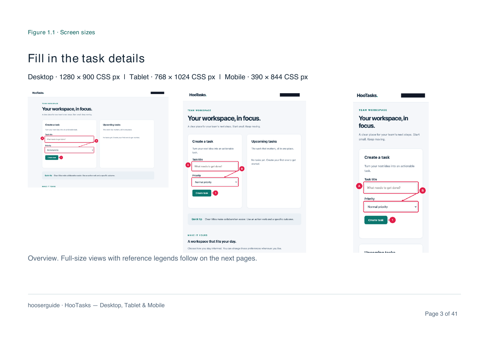

# Present a feature across screen sizes

A responsive run executes the same task separately on two to four screen profiles, then puts the screenshots in one handbook chapter. Start with the `desktop`, `tablet` and `mobile` profiles created by `init`. To capture only one screen, use a [named profile](advanced.md#named-browser-profiles).

## Configure Desktop, Tablet and Mobile

To make the three screens the default selection, add this field to your guide config:

```json
{
  "responsive": {
    "profiles": ["desktop", "tablet", "mobile"],
    "layout": "side-by-side",
    "labels": { "desktop": "Desktop", "tablet": "Tablet", "mobile": "Mobile" }
  }
}
```

Each name must exist under `profiles`. The installed starter uses 1280 × 800 for desktop, 768 × 1024 for tablet and 390 × 844 for mobile. Dimensions in the output are CSS pixels; mobile's device scale factor of 2 does not double the annotation coordinates. You can customize viewport, browser, touch and color scheme per profile.

Install each browser engine selected. Firefox accepts narrow viewports but does not support `isMobile: true`; omit that flag for its profiles. Browser emulation covers the specified settings, not every behavior of a physical device.

## Run and select a feature

From the directory containing the config, use the same profile list and scenario name for both commands. Replace “Get started” if you renamed the starter scenario:

```sh
npx hooserguide validate --profiles desktop,tablet,mobile --scenario "Get started"
npx hooserguide run --profiles desktop,tablet,mobile --scenario "Get started" --json
```

Omit `--profiles` to use the configured selection. `--profile mobile` selects just one screen for that invocation. The two flags cannot be combined. Overrides retain configured labels and layout for the selected names.

Each scenario runs once per selected screen, in order, before the next scenario begins. Browser contexts are independent, but server-side changes carry over: a three-screen test that creates a record may create three records. Use suitable test data, an idempotent workflow or a trusted reset step. Cancelling a run does not undo completed app actions.

## Choose the presentation



| Layout                   | HTML and Markdown                                                                             | PDF                                                                |
| ------------------------ | --------------------------------------------------------------------------------------------- | ------------------------------------------------------------------ |
| `side-by-side` (default) | Compare labeled figures in columns. HTML adapts to the reader's width; Markdown uses a table. | Uncropped overview followed by individual views and their legends. |
| `stacked`                | One screen after the other.                                                                   | Individual detail views without an overview.                       |

Each HTML image links to its full-size PNG. Choosing raw images switches the links too. Shared instructions appear once; when guidance differs, each group names the screens it applies to. Capture titles and order must match across profiles, so use stable names for corresponding screenshots.

To rearrange a successful guide without repeating the app actions, set `RUN` to its output directory:

```sh
npx hooserguide build "$RUN" --output output/stacked --screen-layout stacked --json
```

`manual.screenLayout` (or the CLI override) takes precedence over `responsive.layout`.

## Use through MCP

Pass the same `responsive` and scenario/tag filters to validation and generation:

```json
{
  "responsive": {
    "profiles": ["desktop", "mobile"],
    "layout": "side-by-side",
    "labels": { "desktop": "Desktop", "mobile": "Mobile" }
  },
  "scenario": "Get started"
}
```

`hooserguide_status` exposes configured responsive selection. Generation summaries and `hooserguide_inspect_run` retain the separate execution chapters with `variant.profile`, `variant.scenario`, browser, viewport and device scale factor. Inspect captures by their **execution chapter index**, not the grouped manual chapter number. Pin the returned `runId` for review. `hooserguide_rebuild` accepts `manual.screenLayout`.

## Use through GitLab

Set `responsive` in config or supply the component inputs:

```yaml
inputs:
  profiles: desktop,tablet,mobile
  screen-layout: side-by-side
  orientation: landscape
```

The [GitLab component](gitlab.md) selects the same browser engine for every profile. Use viewport-only mobile profiles on Firefox and choose only one of the `profile` and `profiles` inputs. The job's artifacts and optional ZIP cover the entire comparison.

## Review the evidence

The report keeps one execution chapter per scenario/profile. For example, a three-screen run with two scenarios has six execution chapters but two handbook chapters. A passing report needs every selected profile and matching capture sequences. Failed or skipped profiles do not produce a successful handbook.

Review both masked variants on every profile and inspect the PDF detail pages for readable labels. [Compare two runs](customization.md#inspect-and-compare-evidence) by their scenario/profile pairs. Bundles and rebuilds retain each variant's images and hashes.
