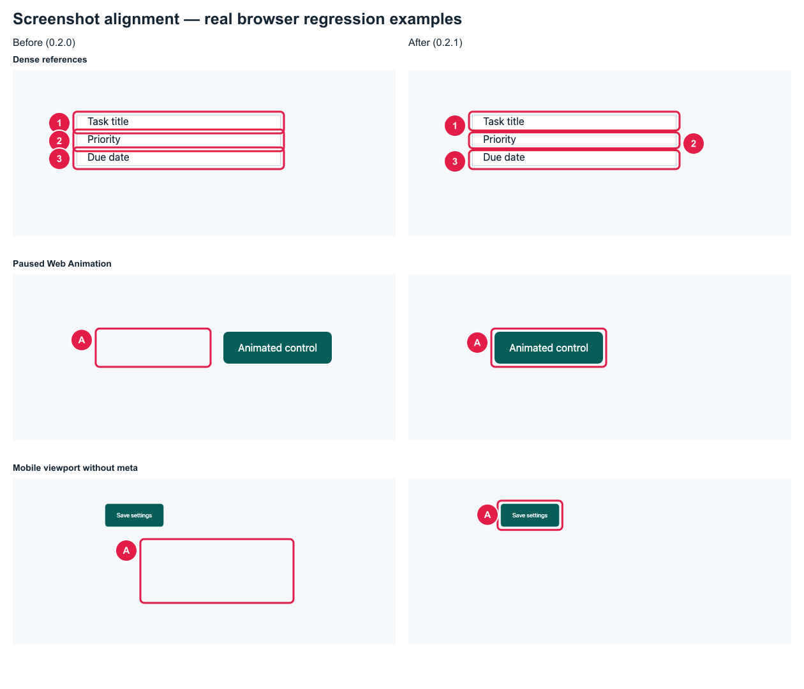
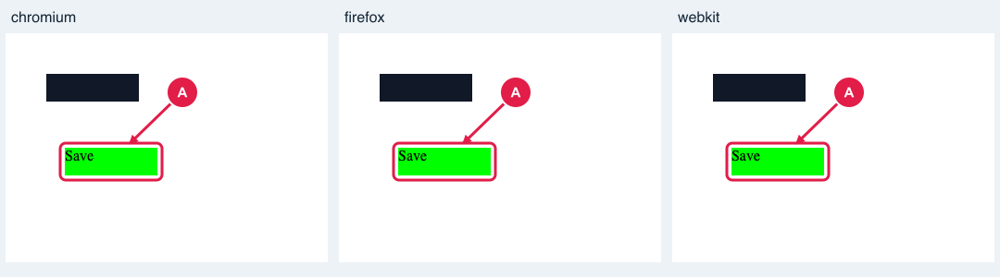

# Review evidence

Use this page to reproduce the checks behind the example handbooks or understand what previous reviews covered. For reviewing a particular application, start with the [review skill](../skills/hooserguide-review/SKILL.md) and the exact run ID.

## November 24, 2026: authoring through offline delivery

| Area                         | What was checked                                                                                                                                                                                                                                                                                                                             |
| ---------------------------- | -------------------------------------------------------------------------------------------------------------------------------------------------------------------------------------------------------------------------------------------------------------------------------------------------------------------------------------------- |
| Application workflow         | The README scenario ran from an installed package against HooTasks. The English and German demos each recorded two chapters and 29 passing steps. Both scenarios reload the app and verify that the task or notification preference survived.                                                                                                |
| Capture and export           | Regression cases include a mask disappearing after scrolling, a font request that never finishes, truncated PNGs, and a rebuild after removing the original HTML and Markdown. Pages and its downloadable ZIP were checked for matching PDF, Markdown and screenshot bytes and the same original report hash.                                |
| Reader and PDF               | All eight English A4 portrait pages and twelve German Letter landscape pages were rendered and visually inspected alongside all sixteen raw/annotated screenshot variants. The offline reader was checked at narrow and desktop widths. A separate stress case checks 160 warning sentences in order across page breaks.                     |
| Responsive guidance          | Three screen profiles shared some instructions and differed on others. The HTML, Markdown and PDF named every relevant screen and placed warnings before actions. A narrow focus capture that previously filled five PDF pages fit on one; a two-scenario landscape fixture fell from 27 to 17 pages while retaining every screenshot pixel. |
| Installation and CI adapters | Checks included a fresh Git install, the packed CLI and MCP server, and local execution of the GitLab and GitHub generation and Pages scripts. Browser qualification covers Chromium, Firefox and WebKit.                                                                                                                                    |

The examples use a loopback app and browser emulation. Local checks do not qualify physical devices or establish a hosted deployment.

## Repeat the review

From a source checkout, install dependencies and the browser versions specified by its lockfile:

```sh
npm ci
npx playwright install chromium firefox webkit
npm run check
npm test
npm run test:browsers
npm run test:package
```

Use `npm run demo:docs` to regenerate the tracked examples in `docs/demo/` and `docs/layout-demo/`. For each run, check the recorded selection and passing assertions, compare every masked raw PNG with its annotated version, open the HTML at desktop and narrow widths, and render every PDF content page. Inspect labels, legends, continuation seams and the saved result. The layout audit and extracted PDF text supplement the visual check.

To reproduce the alignment comparison below, run `npm run review:gallery` in a checkout with the historical 0.2.0 revision. The script compares the old and current capture implementation on the same browser fixtures and writes its intermediate files under `output/review/`.



## Earlier reviews

| Version   | Findings and regression coverage                                                                                                                                                                                                                                                                                                                                                                                                                                                    |
| --------- | ----------------------------------------------------------------------------------------------------------------------------------------------------------------------------------------------------------------------------------------------------------------------------------------------------------------------------------------------------------------------------------------------------------------------------------------------------------------------------------- |
| **0.2.1** | Corrected annotation coordinates on zoomed mobile pages, paused animations and image edges. Tested dense controls, explicit arrow origins, four-character badges and legacy captions without labels. Long legends and instructions were checked for off-page content; PDF seams were adjusted to keep annotation groups together. CLI option rejection, profile overrides, init conflicts, failed context setup and selecting successful MCP rebuild evidence also gained coverage. |
| **0.3.1** | Centralized report consistency checks, contained evidence reads and verification in direct renderers. Compared decoded pixels so recompression no longer looks like a UI change; checked execution steps, tags and browser metadata. Covered noisy plugin output, exclusive scaffold writes and ZIP write/cleanup failures.                                                                                                                                                         |
| **0.4.0** | Added a Linux qualification matrix for Chromium, Firefox and WebKit: saved outcomes, high-DPI scroll and focus, masks, responsive reader, PDF, cancellation and failure evidence. The installed-package smoke exercised the GitLab generation shell, its job-scoped artifacts and a loopback app.                                                                                                                                                                                   |
| **0.5.0** | Qualified responsive execution across desktop, tablet and mobile profiles. Tests covered incomplete or mismatched groups, per-screen guidance, raw-image links, PDF overviews/detail pages, narrow-width stacking and profile preservation through rebuild, compare, bundle, CLI, MCP and GitLab.                                                                                                                                                                                   |
| **0.6.0** | Added static Pages preparation, GitLab job-summary selection, GitHub upload/deployment integration and tests for project subpaths, download links, failed evidence, target collisions and regeneration of previously corrupted reader files.                                                                                                                                                                                                                                        |



## Limits of the evidence

- **Privacy:** A matched mask protects its chosen target, not every sensitive part of the page. Inspect both image variants and the report before sharing.
- **Layout:** A crowded screenshot may need extra padding or separate captures. An annotation group taller than a PDF page cannot stay together; unmarked content can cross a seam.
- **Provenance:** Hashes verify consistency with an unsigned report. A rebuild uses existing screenshots and preserves their capture time. It does not verify today's app.
- **Publication:** An uploaded CI artifact, a passing local component shell and a live site are different results. Verify the intended commit and actual site URL when publishing; see the [Pages checklist](pages.md#verify-deployment).
